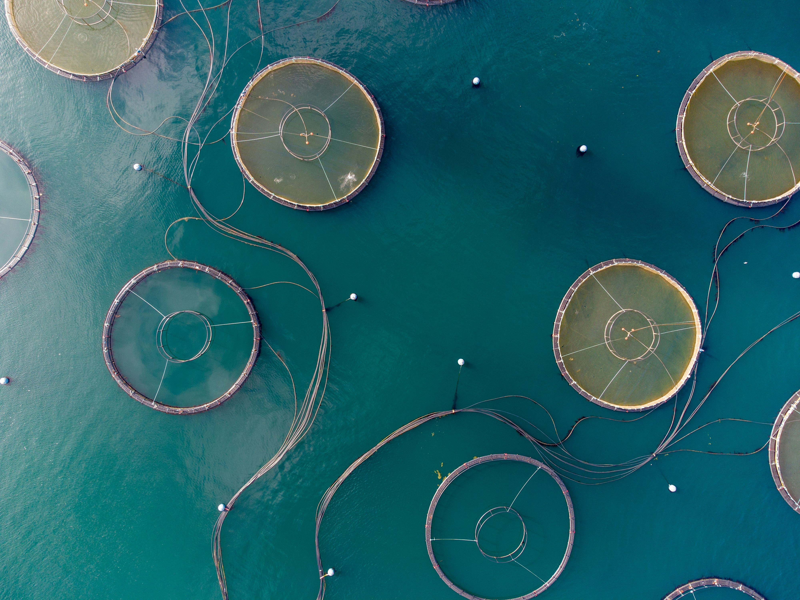

# Prioritizing Potential Auaculture Areas Along the West Coast




<p align="center">
<a href="https://unsplash.com/photos/white-and-silver-round-coins-on-blue-surface-udVjzhI9gXs">Aquaculture</a>
</p>


### Purpose of this Repository


### Package Dependencies 

* `tidyverse`

* `fs`

* `here`

* `tmap`

* `terra`

* `sf`


### File Structure 

```
EDS223-HWK3
├── data
│   ├── average_annual_sst_2008.tif
│   ├── average_annual_sst_2009.tif
│   ├── average_annual_sst_2010.tif
│   ├── average_annual_sst_2011.tif
│   ├── average_annual_sst_2012.tif
│   ├── depth.tif
│   ├── wc_regions_clean.shp
├── images
├── potential_aquaculture.pdf
├── potential_aquaculture.qmd
└── README.md
```


### Repository Contents 

The `data` folder contains the data used for this analysis.

The `images` folder contains images that were used for the README an results sections.


### Results


### Data Information/Access


### Authors and Contributors 

Author: [Ethan Mathews](https://github.com/ethan-mathews24)

Contributor: [Annie Adams](https://github.com/annieradams)


### Citations
